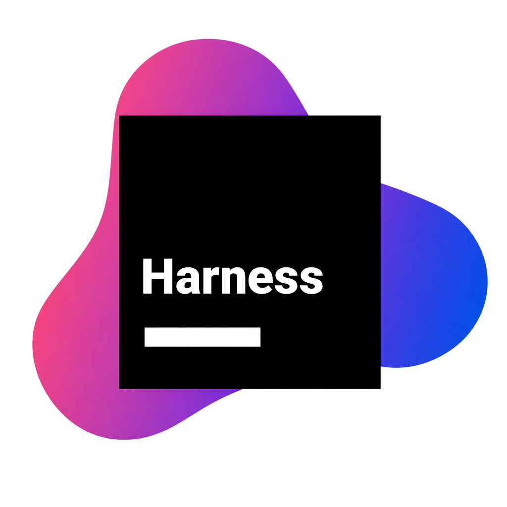
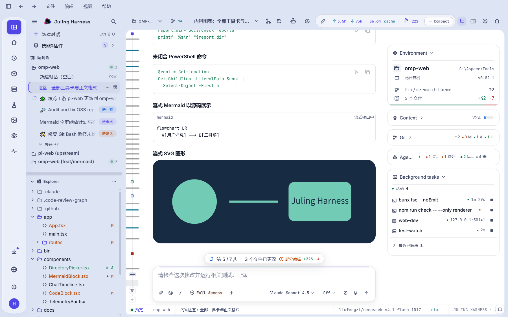
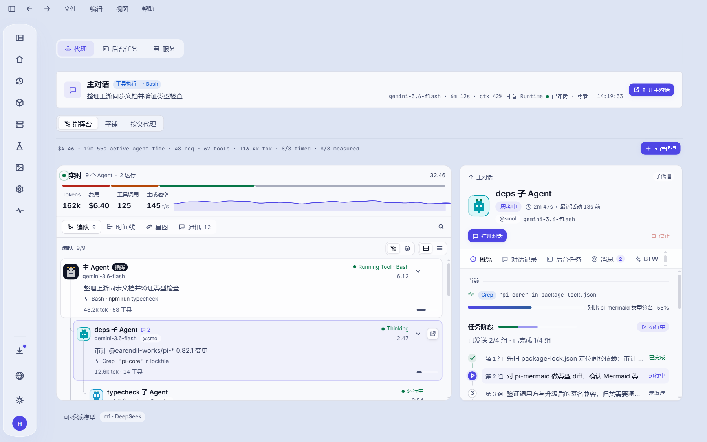
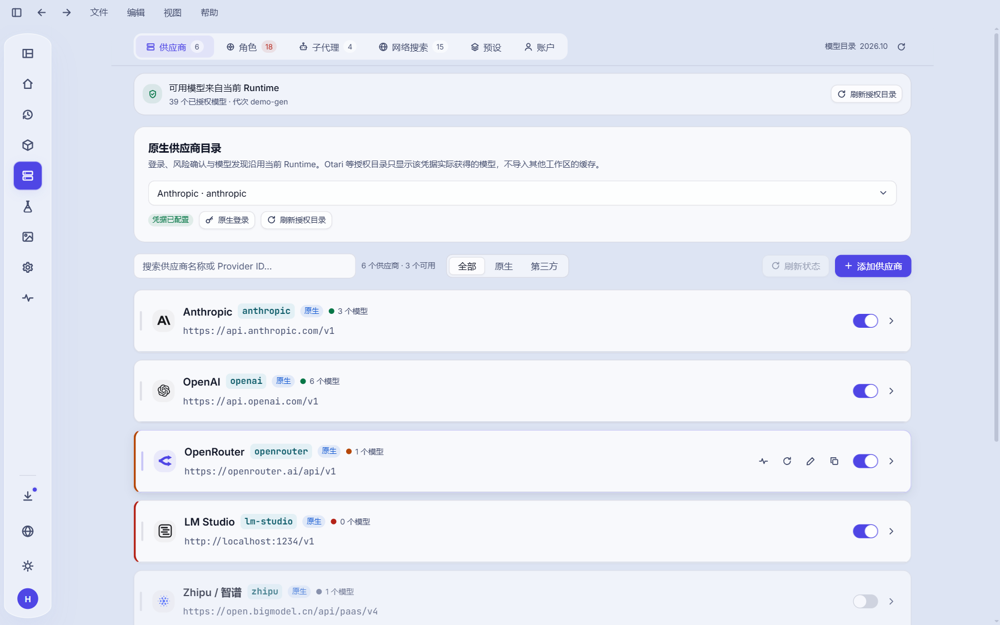
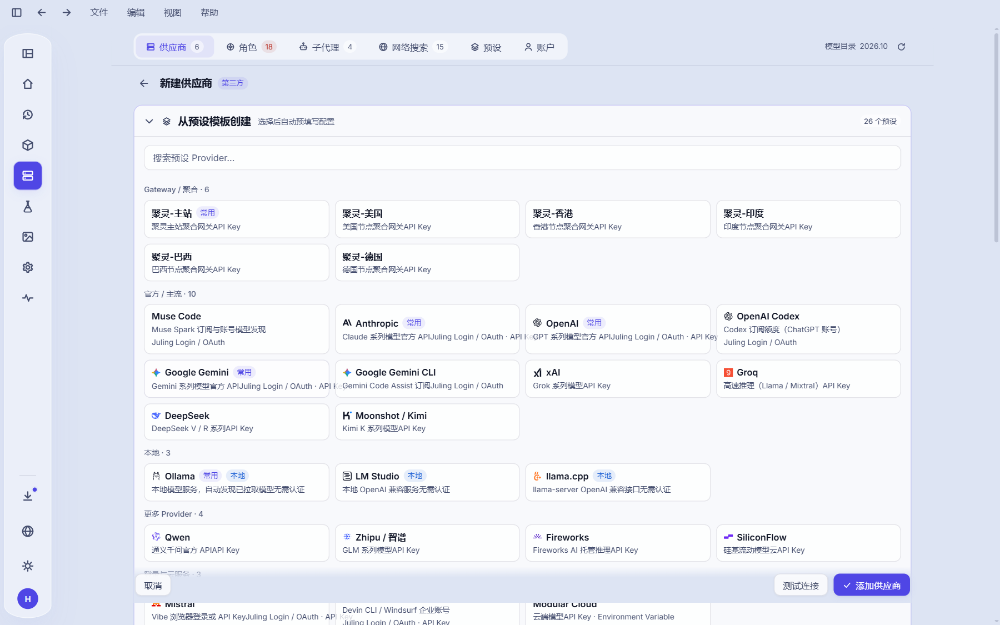
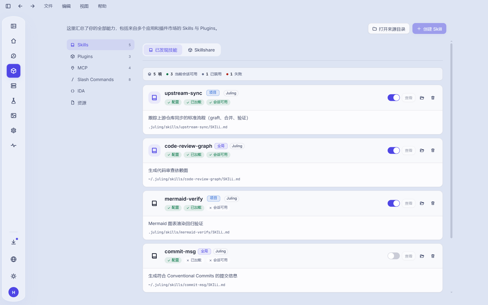
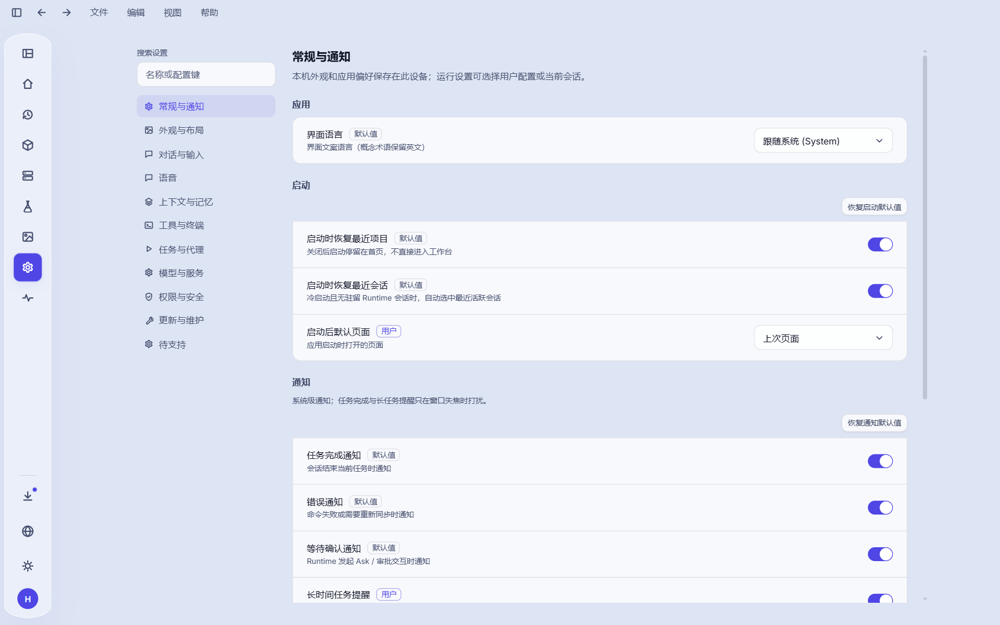

<div align="center">
  
  <h1>Juling Harness</h1>
  <p><b>A native desktop workbench for long-running, multi-agent coding sessions.</b></p>
  <p>One window for every conversation, subagent, model, tool and file.<br />Everything runs through a typed Harness Bridge — no terminal scraping, no keystroke simulation.</p>
</div>

<p align="center">
  
  <br />
  <sub>The workbench: conversations, tool calls, subagents and context on one dockable canvas</sub>
</p>

| Version | Bundled runtime | Platforms | License |
|:--:|:--:|:--:|:--:|
| **1.0.0** | OMP **18.20.2** · `harness.18` | Windows · macOS · Linux | MIT |

---

## Why Juling Harness

Command-line agents are powerful, but long sessions expose three gaps: **context scatters across terminals**, **parallel work is hard to follow**, and **model/tool configuration lacks a single home**.

Juling Harness brings all three into one desktop application:

- **A conversation is a workspace, not a log** — every session owns its window, draft, scroll position and tool state. Arrange them side by side, snap them, or pin them to another display.
- **Agents are visible collaborators** — main agent, subagents, task chains, messages and usage are presented together, with explicit controls to stop, resume or follow up.
- **Configuration is part of the product** — providers, models, roles, subagents, search and permissions live in one interface and write back to validated native configuration.

---

## 01 · A workbench you can rearrange

Conversations and tools share one window system. Drag a session out of the sidebar to float it, or to an edge to preview a snap; move Git, Terminal, Changes, Agents or Browser between the left rail, right sidebar, bottom dock, conversation area and floating windows.

- Multi-display windows, always-on-top, minimized capsules and layout restore
- Light and dark themes built on one restrained visual system
- Six interface languages: 简体中文, English, Русский, 日本語, 한국어, हिन्दी
- Session switching keeps drafts, scroll and expansion state; streaming stays responsive

---

## 02 · Agent Hub: parallel work made legible

<p align="center">
  
  <br />
  <sub>The command deck: formation, timeline, orbit and comms, with the dossier and task stages alongside</sub>
</p>

Agent Hub opens on the command deck. The left side holds formation, timeline, orbit and comms; the right side is the selected agent's dossier. Selection is shared, and stop, resume, messaging and BTW reuse the same confirmations and permissions.

- **Real agent-to-agent messages** — delivered mentions, replies and progress markers, with broadcasts collapsed into one entry; parked and historical agents remain readable
- **One pixel identity** — the same avatar across the deck, Agent Hub, selective commit and conversations; the main agent wears a crown and running agents keep their eyes open
- **A dossier that acts** — parent link, status, runtime, model, context and usage in one panel
- **Traceable task stages** — each sub-task group, its owner and completion state expand in place

---

## 03 · Model configuration: from provider to role

<table>
<tr>
<td width="50%">

<br /><sub>Providers: status, credentials, model counts and switches</sub>
</td>
<td width="50%">

<br /><sub>Presets: expanded by default, gateways first</sub>
</td>
</tr>
</table>

- **Preset templates open by default** — choosing a template pre-fills API, endpoint, website and authentication
- **Juling gateways first** — the Gateway / Aggregators group ships main, US, Hong Kong, India, Brazil and Germany nodes
- **From provider to role** — assign models and thinking levels to `@default`, `@plan`, `@task` and the rest
- **Auditable native config** — every write is validated; the UI and the YAML stay in agreement

---

## 04 · Capabilities, files, terminal and browser

<table>
<tr>
<td width="50%">

<br /><sub>Capabilities: MCP, tools, skills and runtime features</sub>
</td>
<td width="50%">

<br /><sub>Settings: interface, appearance, input and session behavior</sub>
</td>
</tr>
</table>

- **Built-in browser** — native tabs, persistent login space, Console / Network / downloads, and an “Agent | Me” handoff
- **File viewer** — editing, diffs, Markdown, PDF, images, audio/video and spreadsheets over one local/SSH read-write path
- **SSH workspaces** — remote runtime, terminal and tmux attachment with reconnect
- **Capabilities center** — status, source and permissions for MCP servers, skills, tools and runtime features
- **Statistics and diagnostics** — token usage, session timeline, runtime health, logs and update checks

---

## 05 · Built for the long run

- **Time Travel** — per-turn workspace checkpoints; restore code, restore the conversation branch, or both
- **Session recovery** — resume history with its model; continue in another workspace when the original directory is gone
- **Workspace recovery** — detect stale projects at startup, fall back safely, and re-pick or forget records from diagnostics
- **In-app updates** — signed, differential downloads with restart install and rollback on Windows, macOS and Linux
- **Runtime isolation** — the desktop only starts a signed, version-matched runtime; it never depends on a global CLI or replaces your `omp`

---

## Architecture

```text
┌──────────────────────────────┐
│ Electron Main                │  windows, terminal, files, updates, remote
├──────────────────────────────┤
│ React Renderer               │  workbench, Agent Hub, models, settings
├──────────────────────────────┤
│ Harness Host                 │  sessions, archive, Time Travel, ledger
├──────────── Harness Bridge ──┤  typed frames · request / receipt / event / snapshot
│ Juling Runtime (OMP 18.20.2) │  models, tools, agents, compaction, prediction
└──────────────────────────────┘
```

The runtime side is maintained in two layers:

- **Overlay** — Harness-owned files under `packages/coding-agent/src/harness/**`; ordinary source with ordinary diffs
- **Seam** — patches that touch only upstream-owned files, grouped by subsystem and regenerated deterministically

The pinned upstream commit, patchset version and artifact signatures are cross-checked by the build, which fails before packaging if any side drifts.

---

## Quick start

| Requirement | Version |
|---|---|
| Node.js | 22 or newer |
| npm | bundled with Node.js |
| Bun | 1.4.4 (when building the runtime) |
| Rust | only when rebuilding native runtime pieces |

```bash
npm install
npm run build          # compile workspaces, renderer and desktop
npm run preview        # development preview against the real Host
npm run check          # architecture, selector/motion rules, types and core tests
```

On Windows, `启动预览版.cmd` opens the demo preview and `启动生产版.cmd` reproduces the installed layout.

Installers and update artifacts are published on [Releases](https://github.com/177911-juling/Juling-Harness/releases). Linux ships `.deb` and `AppImage`, with in-app differential updates since 1.0.0.

---

## Documentation

| Document | Contents |
|---|---|
| [Getting started](docs/getting-started.md) | Install, first launch, Runtime connection and core workflow |
| [Architecture](docs/architecture.md) | Layers, Harness Bridge, Runtime overlay and seam patches |
| [Workbench docking](docs/workbench-docking.md) | Dock regions, drag snapping, tab groups and layout restore |
| [File browser](docs/file-browser.md) | Files outside the project, pinned folders and SSH browsing |
| [File viewer](docs/file-viewer.md) | Editing, diffs, find and multi-format preview |
| [Built-in browser](docs/browser.md) | Native pages, agent handoff, Console and Network |
| [SSH workspaces](docs/ssh-workspaces.md) | Remote Runtime, files, Git and terminal |
| [Time Travel](docs/time-travel.md) | Turn checkpoints and code/conversation restore |
| [Updates and verification](docs/updates.md) | Differential download, signatures, restart and rollback |
| [Linux client](docs/linux.md) | deb / AppImage install and in-app updates |
| [Localization](docs/localization.md) | Six languages, cross-process sync and fallback |

---

## Platforms

| Platform | Architecture | Package |
|---|---|---|
| Windows | x64 / arm64 | NSIS installer |
| macOS | Apple Silicon | DMG / update ZIP |
| Linux | x64 | deb / AppImage |

---

## License

Juling Harness is released under [MIT](LICENSE).

The runtime is built on [oh-my-pi](https://github.com/can1357/oh-my-pi). Electron, React, Bun and other third-party components keep their own licenses; see [NOTICE](NOTICE) for the notices shipped with the app.
