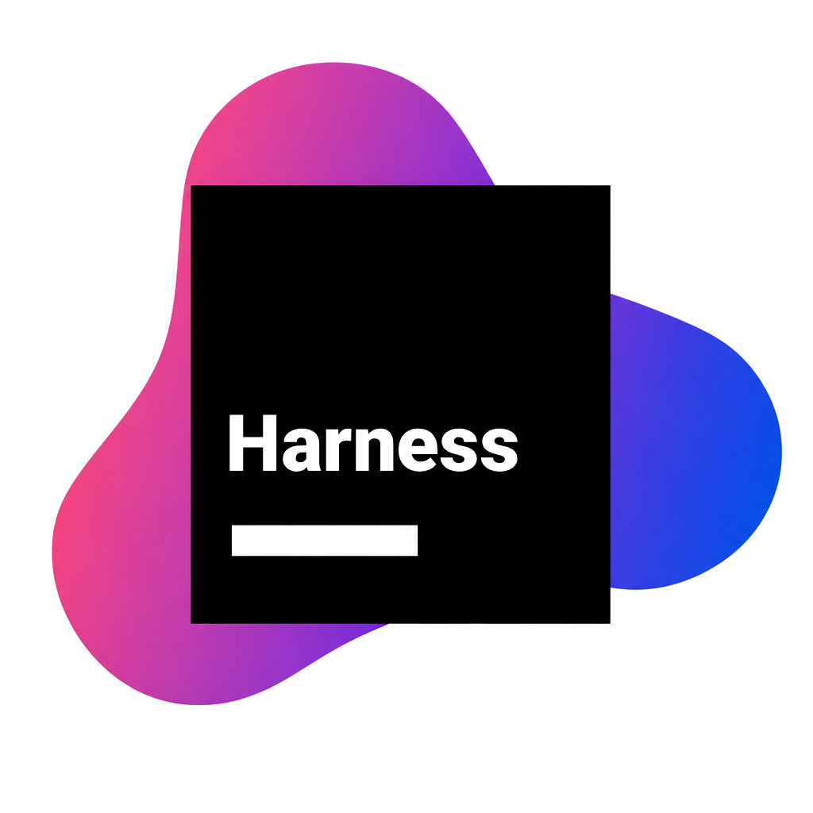
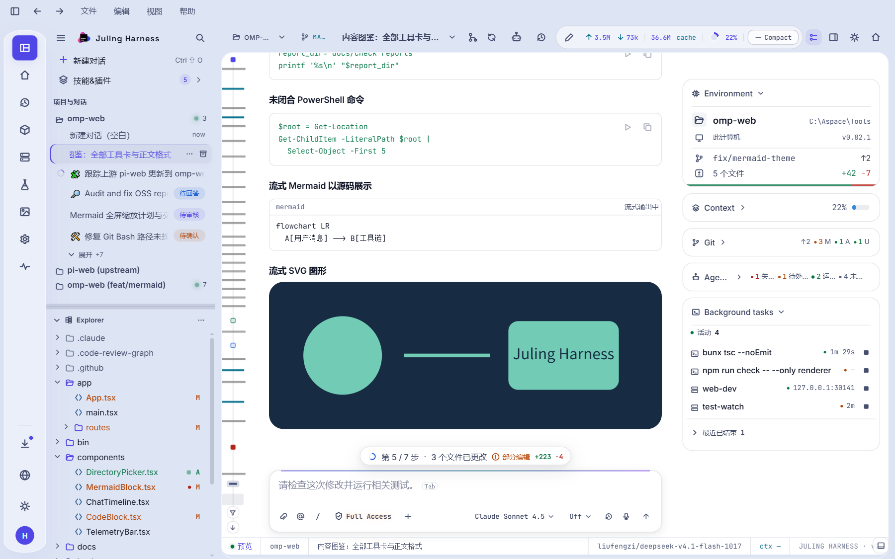
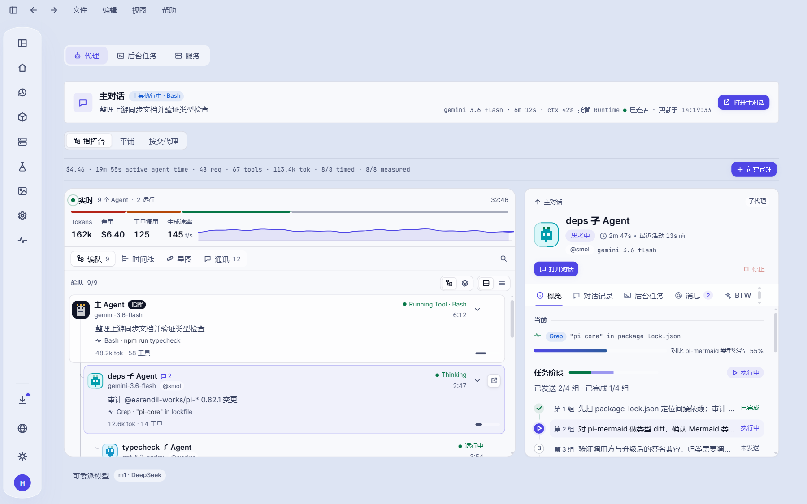
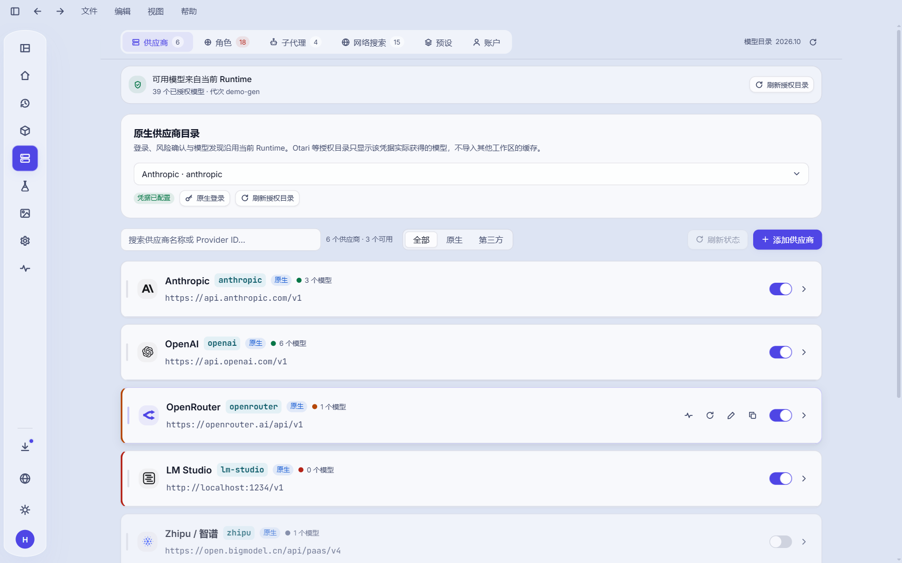
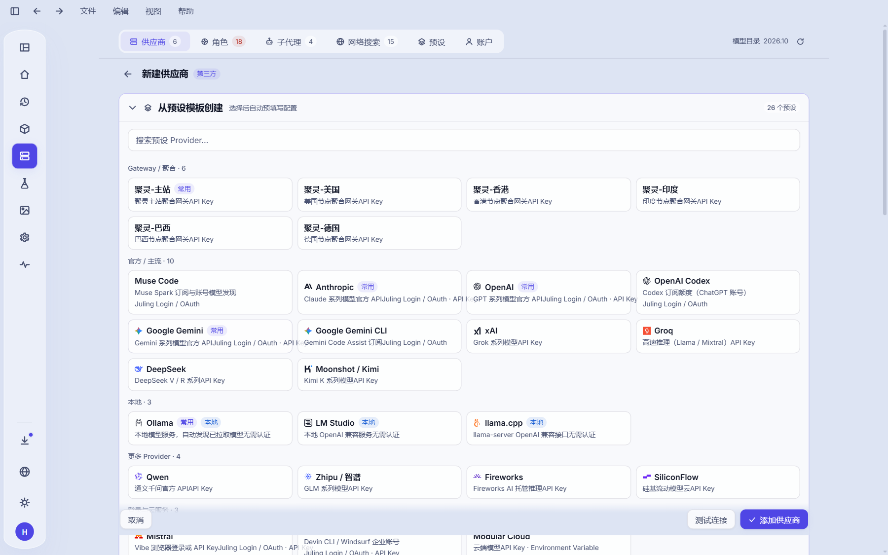
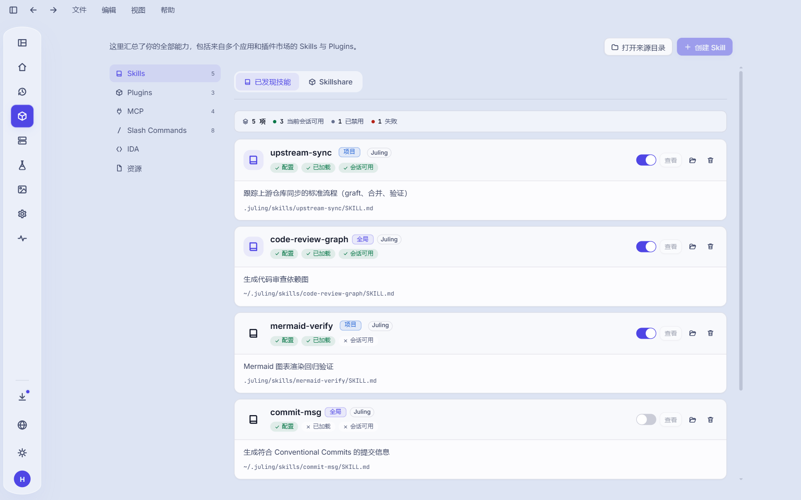
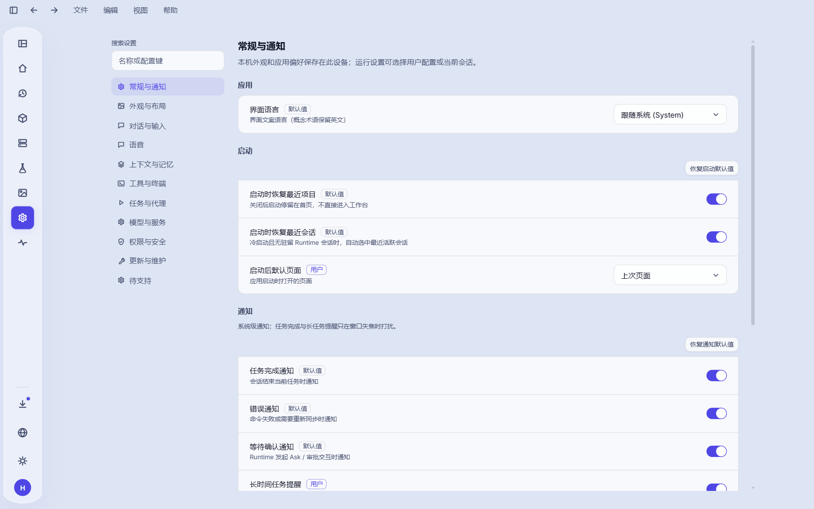

<div align="center">
  
  <h1>Juling Harness</h1>
  <p><b>लंबे समय तक चलने वाले, बहु-एजेंट कोडिंग सेशन के लिए एक नेटिव डेस्कटॉप वर्कबेंच।</b></p>
  <p>
    <a href="README.md">English</a> ·
    <a href="README.zh.md">简体中文</a> ·
    <b>हिन्दी</b>
  </p>
</div>

| संस्करण | अंतर्निहित रनटाइम | प्लेटफ़ॉर्म | लाइसेंस |
|:--:|:--:|:--:|:--:|
| **1.1.0** | OMP **19.0.1** · `harness.7` | Windows · macOS · Linux | MIT |

<p align="center">
  
  <br />
  <sub>वर्कबेंच: बातचीत, टूल कॉल, सबएजेंट और कॉन्टेक्स्ट एक ही डॉक करने योग्य कैनवास पर</sub>
</p>

## अवलोकन

Juling Harness, Juling Runtime के लिए डेस्कटॉप कंसोल है। रनटाइम OMP 19.0.1 पर पिन किया गया, हस्ताक्षरित बिल्ड है। यह लंबे समय तक चलने वाले कोडिंग एजेंट को वास्तविक कार्यक्षेत्र देता है: स्थायी सेशन, दिखने वाले सबएजेंट, टाइप्ड मॉडल कॉन्फ़िगरेशन, और ऐसे टूल जिन्हें टर्मिनल में छिपाने के बजाय फिर से व्यवस्थित किया जा सकता है।

हर क्रिया टाइप्ड **Harness Bridge** से होती है — request, receipt, event और snapshot — टर्मिनल टेक्स्ट पढ़कर, ANSI पार्स करके या कीबोर्ड मैक्रो चलाकर नहीं। इसलिए लंबे सेशन में भी व्यवहार अनुमानित रहता है।

## मुख्य विशेषताएँ

- **सेशन ही वर्कस्पेस** — हर बातचीत का अपना विंडो, ड्राफ़्ट, स्क्रॉल स्थिति और टूल स्थिति होती है। उन्हें साथ रखें, स्नैप करें या दूसरी स्क्रीन पर पिन करें।
- **दिखने वाले Agent** — मुख्य Agent, सबएजेंट, टास्क चेन, संदेश और उपयोग एक ही इंटरफ़ेस में; रोकें, फिर से शुरू करें और आगे पूछें।
- **एक मॉडल सतह** — प्रोवाइडर, मॉडल, भूमिकाएँ, सबएजेंट, खोज, अनुमतियाँ और प्रीसेट एक जगह, सत्यापित नेटिव कॉन्फ़िगरेशन में सहेजे जाते हैं।
- **नेटिव इंटीग्रेशन** — फ़ाइल ब्राउज़र और व्यूअर, टर्मिनल, SSH वर्कस्पेस, ब्राउज़र, Time Travel और हस्ताक्षरित अपडेट ऐप के भीतर।

## वर्कबेंच

बातचीत और टूल एक ही विंडो सिस्टम साझा करते हैं। सेशन को साइडबार से बाहर खींचें तो फ़्लोटिंग विंडो बनती है, किनारे पर ले जाएँ तो स्नैप प्रीव्यू दिखता है। Git, Terminal, Changes, Agents या Browser को बाएँ rail, दाएँ sidebar, निचले dock, बातचीत क्षेत्र और फ़्लोटिंग विंडो के बीच ले जाया या टैब समूह में मिलाया जा सकता है।

- मल्टी-डिस्प्ले विंडो, always-on-top, minimized capsule और लेआउट रिस्टोर
- हल्के और गहरे थीम के लिए एक संयमित विज़ुअल सिस्टम
- छह इंटरफ़ेस भाषाएँ: English, 简体中文, Русский, 日本語, 한국어, हिन्दी
- सेशन बदलने पर ड्राफ़्ट, स्क्रॉल और विस्तारित स्थिति बनी रहती है; स्ट्रीमिंग प्रतिक्रियाशील रहती है

## Agent Hub

<p align="center">
  
  <br />
  <sub>कमांड डेक: फ़ॉर्मेशन, टाइमलाइन, ऑर्बिट और कॉम्स, साथ में डोज़ियर और टास्क चरण</sub>
</p>

Agent Hub कमांड डेक पर खुलता है। बाईं ओर फ़ॉर्मेशन, टाइमलाइन, ऑर्बिट और कॉम्स हैं; दाईं ओर चुने गए Agent का डोज़ियर। चयन साझा रहता है, और रोकना, फिर से शुरू करना, संदेश भेजना तथा BTW वही पुष्टि और अनुमतियाँ उपयोग करते हैं।

- **वास्तविक Agent-से-Agent संदेश** — पहुँचे हुए `@`, उत्तर और प्रगति संकेत; broadcast एक प्रविष्टि में मिल जाता है
- **एक पिक्सेल पहचान** — डेक, Agent Hub, selective commit और बातचीत में एक ही अवतार
- **क्रियाशील डोज़ियर** — parent link, स्थिति, runtime, मॉडल, कॉन्टेक्स्ट और उपयोग एक पैनल में
- **ट्रेस करने योग्य टास्क चरण** — हर उप-कार्य समूह, उसका owner और पूर्णता स्थिति वहीं खुलती है

## मॉडल और प्रोवाइडर

<table>
<tr>
<td width="50%">

<br /><sub>प्रोवाइडर: स्थिति, क्रेडेंशियल, मॉडल संख्या और स्विच</sub>
</td>
<td width="50%">

<br /><sub>प्रीसेट: डिफ़ॉल्ट रूप से खुले, Gateway पहले</sub>
</td>
</tr>
</table>

- **प्रीसेट टेम्पलेट डिफ़ॉल्ट रूप से खुलते हैं** — टेम्पलेट चुनने पर API, endpoint, वेबसाइट और authentication भर जाते हैं
- **Juling gateway पहले** — Gateway / Aggregators समूह में main, US, Hong Kong, India, Brazil और Germany नोड हैं
- **प्रोवाइडर से भूमिका तक** — `@default`, `@plan`, `@task` और अन्य भूमिकाओं के लिए मॉडल और thinking स्तर चुनें
- **ऑडिट योग्य नेटिव कॉन्फ़िग** — हर लेख सत्यापित होता है; UI और YAML एक जैसे रहते हैं

## क्षमताएँ और टूल

<table>
<tr>
<td width="50%">

<br /><sub>क्षमताएँ: MCP, टूल, स्किल और रनटाइम सुविधाएँ</sub>
</td>
<td width="50%">

<br /><sub>सेटिंग्स: इंटरफ़ेस, रूप, इनपुट और सेशन व्यवहार</sub>
</td>
</tr>
</table>

- **अंतर्निहित ब्राउज़र** — नेटिव टैब, स्थायी लॉगिन स्थान, Console / Network / डाउनलोड, और “Agent | मैं” नियंत्रण हस्तांतरण
- **फ़ाइल ब्राउज़र और व्यूअर** — प्रोजेक्ट के बाहर की फ़ाइलें, संपादन, diff, Markdown, PDF, चित्र, ऑडियो/वीडियो और स्प्रेडशीट, स्थानीय और SSH के लिए एक ही पथ
- **SSH वर्कस्पेस** — दूरस्थ runtime, टर्मिनल और tmux सेशन, पुनः कनेक्ट सहित
- **क्षमता केंद्र** — MCP सर्वर, स्किल, टूल और रनटाइम सुविधाओं की स्थिति, स्रोत और अनुमतियाँ
- **आँकड़े और निदान** — token उपयोग, सेशन टाइमलाइन, runtime स्वास्थ्य, लॉग और अपडेट जाँच

## लंबे उपयोग के लिए डिज़ाइन

| क्षमता | कार्य |
|---|---|
| **Time Travel** | प्रति-टर्न वर्कस्पेस चेकपॉइंट; केवल कोड, केवल बातचीत शाखा, या दोनों बहाल करें, बहाली से पहले बैकअप के साथ |
| **सेशन रिकवरी** | इतिहास को उसके मॉडल के साथ फिर से शुरू करें; मूल निर्देशिका न हो तो दूसरे वर्कस्पेस में जारी रखें |
| **वर्कस्पेस रिकवरी** | शुरुआत में अमान्य प्रोजेक्ट पहचानें और सुरक्षित रूप से fallback करें; निदान से निर्देशिका चुनें या रिकॉर्ड भुलाएँ |
| **इन-ऐप अपडेट** | Windows, macOS और Linux पर हस्ताक्षरित differential डाउनलोड, पुनः आरंभ पर इंस्टॉल और विफलता पर rollback |
| **रनटाइम अलगाव** | केवल हस्ताक्षरित और संस्करण-मेल खाता runtime शुरू करें; वैश्विक CLI पर निर्भर न रहें और `omp` को न बदलें |

## आर्किटेक्चर

```text
┌──────────────────────────────┐
│ Electron Main                │  विंडो, टर्मिनल, फ़ाइल, अपडेट, रिमोट
├──────────────────────────────┤
│ React Renderer               │  वर्कबेंच, Agent Hub, मॉडल, सेटिंग्स
├──────────────────────────────┤
│ Harness Host                 │  सेशन, आर्काइव, Time Travel, लेजर
├──────────── Harness Bridge ──┤  टाइप्ड फ़्रेम · request / receipt / event / snapshot
│ Juling Runtime (OMP 19.0.1) │  मॉडल, टूल, Agent, compaction, prediction
└──────────────────────────────┘
```

रनटाइम पक्ष दो परतों में रखा जाता है:

- **Overlay** — `packages/coding-agent/src/harness/**` के अंतर्गत Harness की अपनी फ़ाइलें; सामान्य स्रोत और सामान्य diff
- **Seam** — केवल upstream फ़ाइलों को छूने वाले patch, उपप्रणाली के अनुसार समूहित और नियतात्मक रूप से पुनः उत्पन्न

पिन किया गया upstream commit, patchset संस्करण और artifact हस्ताक्षर build द्वारा परस्पर जाँचे जाते हैं; कोई भी पक्ष बदले तो packaging से पहले विफलता होती है।

## त्वरित शुरुआत

| आवश्यकता | संस्करण |
|---|---|
| Node.js | 22 या नया |
| npm | Node.js के साथ |
| Bun | 1.4.4 (runtime बनाते समय) |
| Rust | केवल native runtime भागों को फिर से बनाते समय |

```bash
npm install
npm run build          # सभी workspace, renderer और desktop संकलित करें
npm run preview        # वास्तविक Host के साथ development preview
npm run check          # architecture, selector/motion नियम, types और core tests
```

Windows पर `启动预览版.cmd` demo preview खोलता है और `启动生产版.cmd` installed layout दोहराता है।

इंस्टॉलर और अपडेट artifacts [Releases](https://github.com/177911-juling/Juling-Harness/releases) पर प्रकाशित होते हैं। Linux के लिए `.deb` और `AppImage`, 1.0.0 से in-app differential updates के साथ।

## दस्तावेज़

| दस्तावेज़ | विषय |
|---|---|
| [Getting started](docs/getting-started.md) | इंस्टॉल, पहला launch, Runtime कनेक्शन और मूल workflow |
| [Architecture](docs/architecture.md) | परतें, Harness Bridge, Runtime overlay और seam patches |
| [Workbench docking](docs/workbench-docking.md) | Dock क्षेत्र, drag snapping, tab समूह और layout restore |
| [File browser](docs/file-browser.md) | प्रोजेक्ट के बाहर की फ़ाइलें, pinned फ़ोल्डर और SSH browsing |
| [File viewer](docs/file-viewer.md) | संपादन, diff, खोज और बहु-स्वरूप preview |
| [Built-in browser](docs/browser.md) | नेटिव पेज, agent handoff, Console और Network |
| [SSH workspaces](docs/ssh-workspaces.md) | दूरस्थ Runtime, फ़ाइलें, Git और टर्मिनल |
| [Time Travel](docs/time-travel.md) | टर्न checkpoints और कोड/बातचीत बहाली |
| [Updates and verification](docs/updates.md) | Differential download, हस्ताक्षर, restart और rollback |
| [Linux client](docs/linux.md) | deb / AppImage इंस्टॉल और in-app updates |
| [Localization](docs/localization.md) | छह भाषाएँ, cross-process sync और fallback |

> तकनीकी गाइड अभी अंग्रेज़ी और चीनी में उपलब्ध हैं।

## प्लेटफ़ॉर्म

| प्लेटफ़ॉर्म | आर्किटेक्चर | पैकेज |
|---|---|---|
| Windows | x64 / arm64 | NSIS installer |
| macOS | Apple Silicon | DMG / update ZIP |
| Linux | x64 | deb / AppImage |

## लाइसेंस

Juling Harness [MIT](LICENSE) लाइसेंस के अंतर्गत जारी है।

रनटाइम [oh-my-pi](https://github.com/can1357/oh-my-pi) पर आधारित है। Electron, React, Bun और अन्य तृतीय-पक्ष घटक अपने-अपने लाइसेंस रखते हैं; ऐप के साथ वितरित सूचनाएँ [NOTICE](NOTICE) में हैं।
