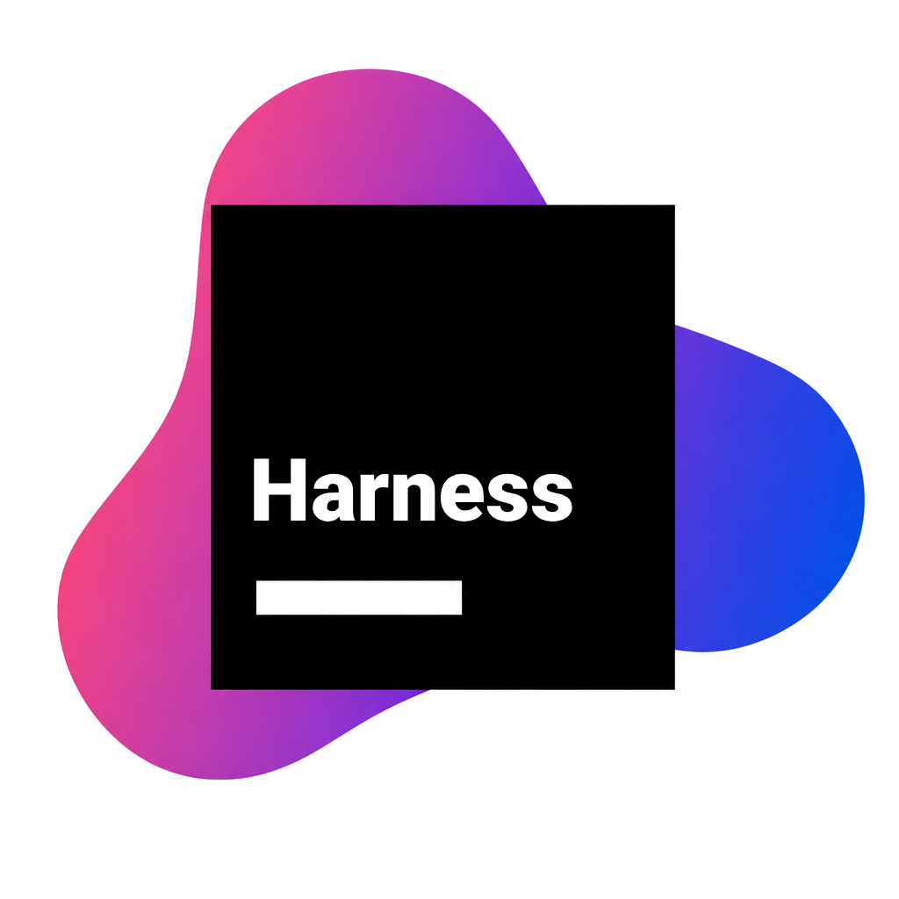
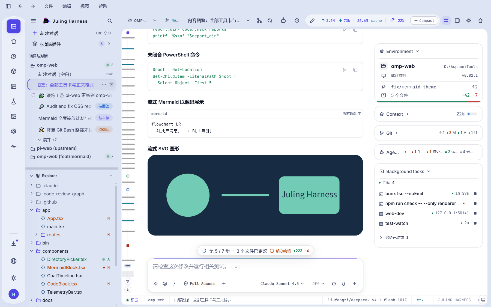
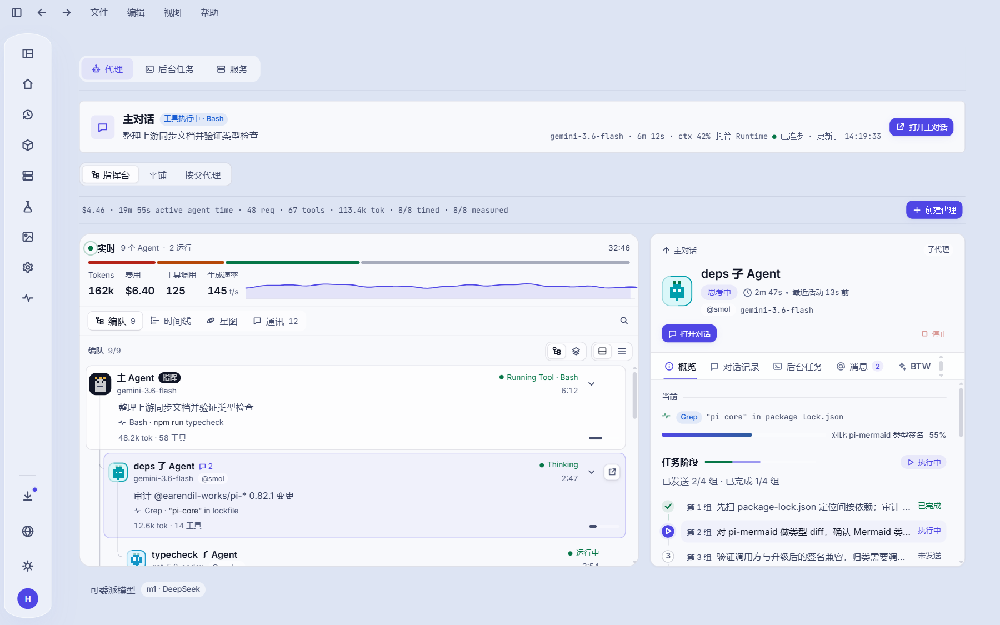
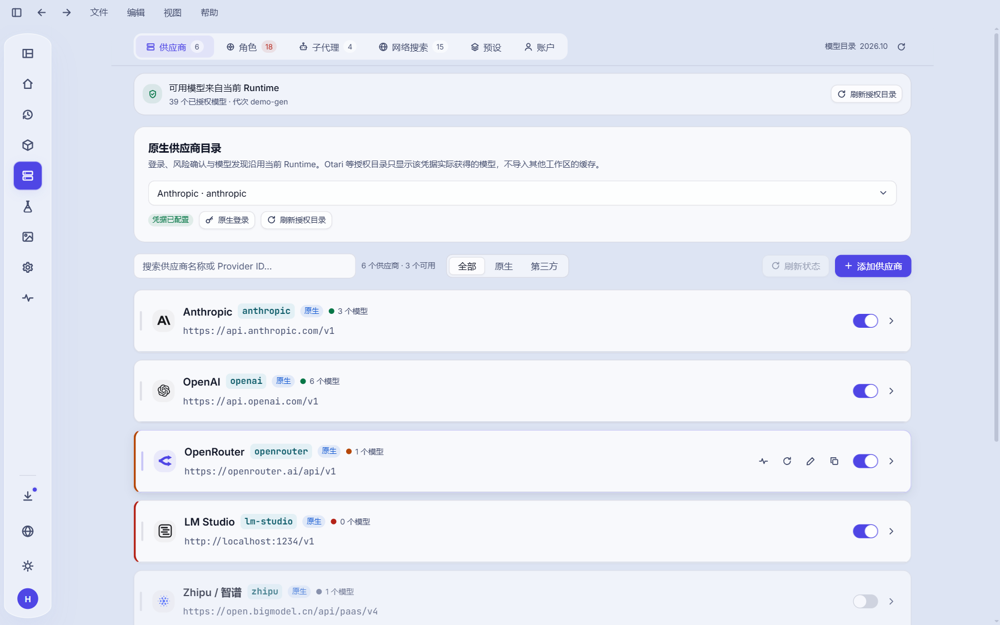
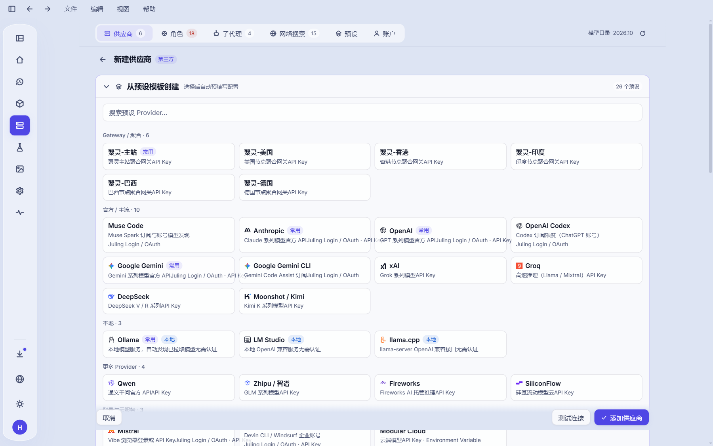
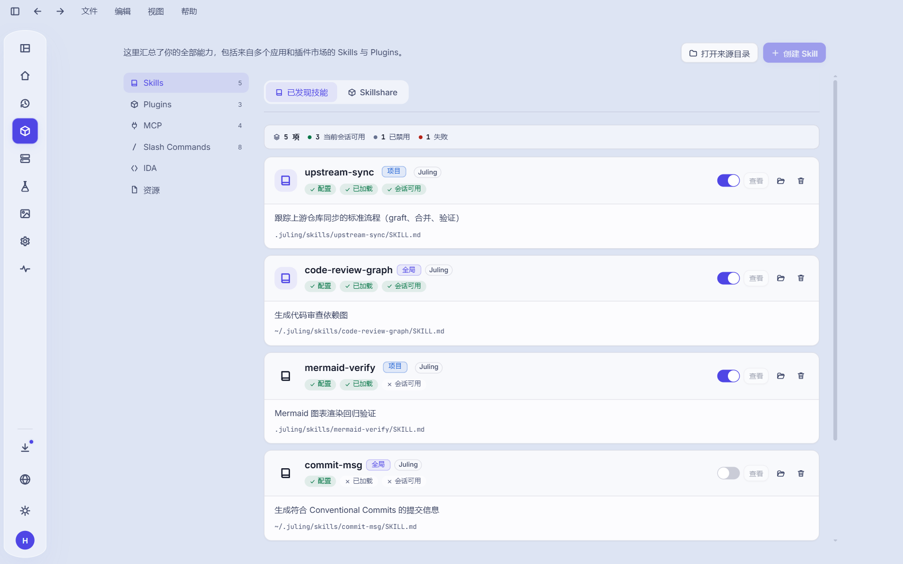
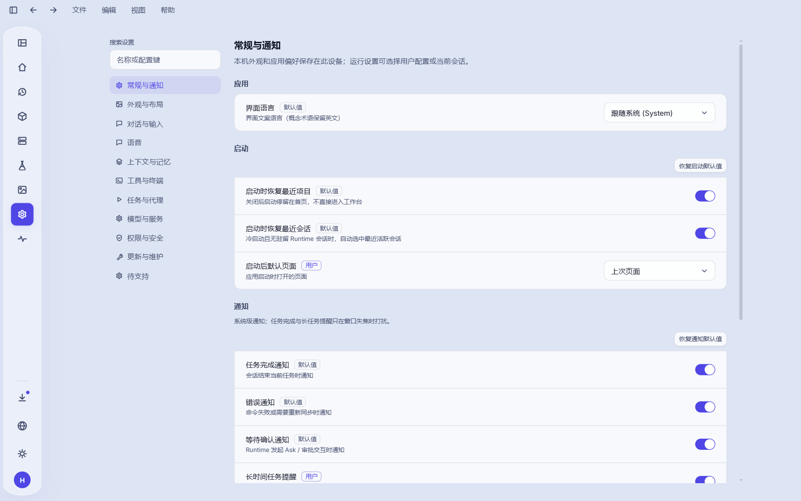

<div align="center">
  
  <h1>Juling Harness</h1>
  <p><b>A native desktop workbench for long-running, multi-agent coding sessions.</b></p>
  <p>
    <b>English</b> ·
    <a href="README.zh.md">简体中文</a> ·
    <a href="README.hi.md">हिन्दी</a>
  </p>
</div>

| Version | Bundled runtime | Platforms | License |
|:--:|:--:|:--:|:--:|
| **1.0.1** | OMP **18.20.2** · `harness.18` | Windows · macOS · Linux | MIT |

<p align="center">
  
  <br />
  <sub>Workbench: conversations, tool calls, subagents and context on one dockable canvas</sub>
</p>

## Overview

Juling Harness is the desktop console for the Juling Runtime, a signed build of the OpenMP coding engine pinned to OMP 18.20.2. It gives long-running coding agents a real workspace: persistent sessions, visible subagents, typed model configuration, and tools that can be rearranged instead of buried in a terminal.

Every action goes through the typed **Harness Bridge** — requests, receipts, events and snapshots — rather than screen scraping, ANSI parsing or key macros. The result is a desktop application that stays predictable as sessions grow.

## Highlights

- **Sessions as workspaces** — each conversation keeps its own window, draft, scroll position and tool state. Arrange, snap or pin them.
- **Visible agents** — main agent, subagents, task chains, messages and usage share one interface with stop, resume and follow-up controls.
- **One model surface** — providers, models, roles, subagents, search, permissions and presets in one place, written back to validated native configuration.
- **Native integration** — file browser and viewer, terminal, SSH workspaces, browser, Time Travel and signed updates without leaving the app.

## The workbench

Conversations and tools share one window system. Drag a session out of the sidebar to float it, or to an edge to preview a snap. Move Git, Terminal, Changes, Agents or Browser between the left rail, right sidebar, bottom dock, conversation area and floating windows.

- Multi-display windows, always-on-top, minimized capsules and layout restore
- One restrained visual system for light and dark themes
- Six interface languages: English, 简体中文, Русский, 日本語, 한국어, हिन्दी
- Session switching preserves drafts, scroll and expansion state; streaming stays responsive

## Agent Hub

<p align="center">
  
  <br />
  <sub>Command deck: formation, timeline, orbit and comms, with the dossier and task stages alongside</sub>
</p>

Agent Hub opens on the command deck. The left side holds formation, timeline, orbit and comms; the right side is the selected agent's dossier. Selection is shared, and stop, resume, messaging and BTW reuse the same confirmations and permissions.

- **Real agent-to-agent messages** — delivered mentions, replies and progress markers, with broadcasts collapsed into one entry
- **One pixel identity** — the same avatar across the deck, Agent Hub, selective commit and conversations
- **A dossier that acts** — parent link, status, runtime, model, context and usage in one panel
- **Traceable task stages** — each sub-task group, its owner and completion state expand in place

## Models and providers

<table>
<tr>
<td width="50%">

<br /><sub>Providers: status, credentials, model counts and switches</sub>
</td>
<td width="50%">

<br /><sub>Presets: expanded by default, gateways first</sub>
</td>
</tr>
</table>

- **Preset templates open by default** — choosing a template pre-fills API, endpoint, website and authentication
- **Juling gateways first** — the Gateway / Aggregators group ships main, US, Hong Kong, India, Brazil and Germany nodes
- **From provider to role** — assign models and thinking levels to `@default`, `@plan`, `@task` and the rest
- **Auditable native config** — every write is validated; the UI and the YAML stay in agreement

## Capabilities and tools

<table>
<tr>
<td width="50%">

<br /><sub>Capabilities: MCP, tools, skills and runtime features</sub>
</td>
<td width="50%">

<br /><sub>Settings: interface, appearance, input and session behavior</sub>
</td>
</tr>
</table>

- **Built-in browser** — native tabs, persistent login space, Console / Network / downloads, and an “Agent | Me” handoff
- **File browser and viewer** — project-external files, editing, diffs, Markdown, PDF, images, audio/video and spreadsheets over one local/SSH path
- **SSH workspaces** — remote runtime, terminal and tmux attachment with reconnect
- **Capabilities center** — status, source and permissions for MCP servers, skills, tools and runtime features
- **Statistics and diagnostics** — token usage, session timeline, runtime health, logs and update checks

## Built for the long run

| Capability | What it does |
|---|---|
| **Time Travel** | Per-turn workspace checkpoints; restore code, the conversation branch, or both, with a pre-restore backup |
| **Session recovery** | Resume history with its model; continue in another workspace when the original directory is gone |
| **Workspace recovery** | Detect stale projects at startup, fall back safely, and re-pick or forget records from diagnostics |
| **In-app updates** | Signed differential downloads with restart install and rollback on Windows, macOS and Linux |
| **Runtime isolation** | Start only a signed, version-matched runtime; never depend on a global CLI or replace your `omp` |

## Architecture

```text
┌──────────────────────────────┐
│ Electron Main                │  windows, terminal, files, updates, remote
├──────────────────────────────┤
│ React Renderer               │  workbench, Agent Hub, models, settings
├──────────────────────────────┤
│ Harness Host                 │  sessions, archive, Time Travel, ledger
├──────────── Harness Bridge ──┤  typed frames · request / receipt / event / snapshot
│ Juling Runtime (OMP 18.20.2) │  models, tools, agents, compaction, prediction
└──────────────────────────────┘
```

The runtime side is maintained in two layers:

- **Overlay** — Harness-owned files under `packages/coding-agent/src/harness/**`, ordinary source with ordinary diffs
- **Seam** — patches that touch only upstream-owned files, grouped by subsystem and regenerated deterministically

The pinned upstream commit, patchset version and artifact signatures are cross-checked by the build, which fails before packaging if any side drifts.

## Quick start

| Requirement | Version |
|---|---|
| Node.js | 22 or newer |
| npm | bundled with Node.js |
| Bun | 1.4.4 (when building the runtime) |
| Rust | only when rebuilding native runtime pieces |

```bash
npm install
npm run build          # compile workspaces, renderer and desktop
npm run preview        # development preview against the real Host
npm run check          # architecture, selector/motion rules, types and core tests
```

On Windows, `启动预览版.cmd` opens the demo preview and `启动生产版.cmd` reproduces the installed layout.

Installers and update artifacts are published on [Releases](https://github.com/177911-juling/Juling-Harness/releases). Linux ships `.deb` and `AppImage`, with in-app differential updates since 1.0.0.

## Documentation

| Document | Contents |
|---|---|
| [Getting started](docs/getting-started.md) | Install, first launch, Runtime connection and core workflow |
| [Architecture](docs/architecture.md) | Layers, Harness Bridge, Runtime overlay and seam patches |
| [Workbench docking](docs/workbench-docking.md) | Dock regions, drag snapping, tab groups and layout restore |
| [File browser](docs/file-browser.md) | Files outside the project, pinned folders and SSH browsing |
| [File viewer](docs/file-viewer.md) | Editing, diffs, find and multi-format preview |
| [Built-in browser](docs/browser.md) | Native pages, agent handoff, Console and Network |
| [SSH workspaces](docs/ssh-workspaces.md) | Remote Runtime, files, Git and terminal |
| [Time Travel](docs/time-travel.md) | Turn checkpoints and code/conversation restore |
| [Updates and verification](docs/updates.md) | Differential download, signatures, restart and rollback |
| [Linux client](docs/linux.md) | deb / AppImage install and in-app updates |
| [Localization](docs/localization.md) | Six languages, cross-process sync and fallback |

## Platforms

| Platform | Architecture | Package |
|---|---|---|
| Windows | x64 / arm64 | NSIS installer |
| macOS | Apple Silicon | DMG / update ZIP |
| Linux | x64 | deb / AppImage |

## License

Juling Harness is released under [MIT](LICENSE).

The runtime is built on [oh-my-pi](https://github.com/can1357/oh-my-pi). Electron, React, Bun and other third-party components keep their own licenses; see [NOTICE](NOTICE) for the notices shipped with the app.
